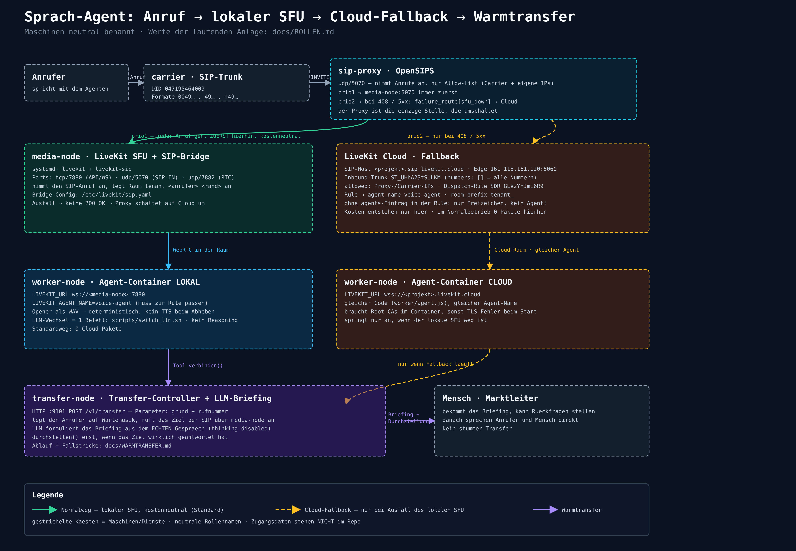
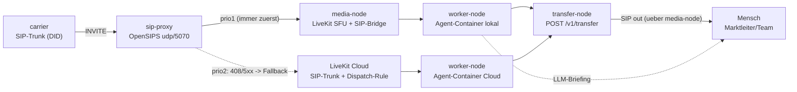

# Voice-Fallback-Architektur — SIP-Proxy, lokaler SFU, LiveKit-Cloud-Fallback, Warmtransfer

Nachbau-Dokumentation einer Telefonie-Anlage für einen Sprach-Agenten:

- Eingehender Anruf landet über einen **Carrier** (SIP-Trunk) auf einem **SIP-Proxy** (OpenSIPS).
- Der Proxy schickt den Anruf **bevorzugt an den lokalen SFU** (LiveKit, self-hosted) inkl. **SIP-Bridge**.
- Antwortet der lokale SFU **nicht** (aus, kaputt, Neustart), schaltet der Proxy per **failure_route** automatisch auf **LiveKit Cloud** um — der Agent springt dort an, der Anrufer merkt nur eine kurze Verzögerung.
- Der Agent kann einen **Warmtransfer** zum Menschen (Marktleiter) aufbauen: Wartemusik, LLM-formuliertes Briefing, Rückfrage, erst dann durchstellen.

Ziel dieses Repos: **eine dritte Person kann den kompletten Aufbau (inkl. Fallback und Warmtransfer) nachbauen**, inklusive der Fallstricke, die uns Tage gekostet haben.

Maschinen werden hier **nur mit Rollennamen** bezeichnet (`sip-proxy`, `media-node`, …). Die konkreten Werte einer laufenden Installation stehen in [`docs/ROLLEN.md`](docs/ROLLEN.md).

---

## 1. Gesamtbild (groß)



- **Vektorfassung (beliebig vergrößerbar):** [`docs/gesamtbild.svg`](docs/gesamtbild.svg) — auf GitHub anklicken, zoomt ohne Qualitätsverlust
- **Zum Selbst-Rendern/Skalieren:** [`docs/gesamtbild.html`](docs/gesamtbild.html) (im Browser öffnen, Zoom unbegrenzt)
- PNG in 5200 × 3600 px (auch für Ausdruck/Präsentation)



*(GitHub rendert das Bild; im Terminal ist die Textfassung unter Abschnitt 2 lesbar.)*

## 2. Rollen (neutrale Namen)

```
———————————————————————————————————————————————————————————
  carrier            SIP-Trunk-Anbieter, liefert die DID
                     (Nummer des Kunden) per UDP an den Proxy
———————————————————————————————————————————————————————————

———————————————————————————————————————————————————————————
  sip-proxy          OpenSIPS · udp/5070
                     · Allow-List (nur Carrier-IPs)
                     · prio1  → media-node:5070
                     · prio2  → LiveKit Cloud (Fallback)
———————————————————————————————————————————————————————————

———————————————————————————————————————————————————————————
  media-node         LiveKit SFU (self-hosted) + SIP-Bridge
                     · tcp/7880  WebSocket/API (SFU)
                     · udp/5070  SIP-IN von der Bridge
                     · udp/7882  WebRTC/ICE (Medien)
———————————————————————————————————————————————————————————

———————————————————————————————————————————————————————————
  worker-node        Agent-Worker (Node.js, @livekit/agents)
                     · Container "…-local" → wss://media-node
                     · Container "…cloud" → wss://<projekt>.livekit.cloud
———————————————————————————————————————————————————————————

———————————————————————————————————————————————————————————
  transfer-node      Warmtransfer-Controller (HTTP)
                     · POST /v1/transfer  (Port 9101)
                     · baut den Anruf zum Ziel über media-node auf
———————————————————————————————————————————————————————————

———————————————————————————————————————————————————————————
  LiveKit Cloud      Fallback-SFU (managed)
                     · SIP-Trunk (DID-Liste + allow-list)
                     · Dispatch-Rule → Agent-Name, Raum-Präfix
———————————————————————————————————————————————————————————
```

---

## 3. Normalweg (lokaler Betrieb, kostenneutral)

> Anbindung ohne feste Ziel-IP: Der `sip-proxy` hängt per **SIP-Registrierung** am Anbieter
> (Auffrischung alle 300 s). Deshalb ist ein Ersatz durch eine Maschine mit **anderer IP** ohne
> Änderung beim Anbieter möglich — Details in [`docs/BETRIEB.md`](docs/BETRIEB.md).

```
 Anrufer
   │  wählt DID  (z. B. 0471 …)
   ▼
———————————————————————
  carrier              SIP/UDP
———————————————————————
   │  INVITE sip:<DID>@<carrier>
   ▼
———————————————————————
  sip-proxy            udp/5070  (Allow-List prüft Carrier-IP)
   │  prio1: $du = sip:<media-node>:5070   +  t_on_failure("sfu_down")
   ▼
———————————————————————
  media-node           SIP-Bridge → Raum  tenant_<caller>_<random>
———————————————————————
   │  WebRTC
   ▼
———————————————————————
  worker-node          Agent  (agent_name = <agent>)
   │  Opener als WAV  →  Anrufer hört "Guten Tag! …"
———————————————————————
```

## 4. Fallback-Weg (lokaler SFU aus / kaputt)

```
  sip-proxy ──INVITE──▶ media-node:5070 ──408/5xx──▶ sip-proxy
                                                       │
                        failure_route[sfu_down]  ◀──────┘
                        $ru = sip:<DID>@<cloud-sip-host>
                        $du = sip:<cloud-edge-ip>:5060
                                                       │
                                                       ▼
———————————————————————————————————————————————————————————
  LiveKit Cloud
   · SIP-Trunk  numbers = [<DID in allen Formaten>]
                allowed_addresses = [<sip-proxy-IP>/32, …]
   · Dispatch-Rule  →  roomConfig.agents = [{agentName: <agent>}]
                       Raum-Präfix <praefix>_
———————————————————————————————————————————————————————————
                                                       │  WebRTC
                                                       ▼
———————————————————————————————————————————————————————————
  worker-node        Cloud-Worker-Container (wss://…livekit.cloud)
                     → Agent spricht wie im Normalbetrieb
———————————————————————————————————————————————————————————
```

Wichtig: der **worker-node** ist bei beiden Wegen derselbe — nur der Container (und damit die `LIVEKIT_URL`) unterscheidet sich. Details: [`docs/FALLBACK.md`](docs/FALLBACK.md).

## 5. Warmtransfer (Agent → Mensch)

```
  Anrufer ──▶ Agent (worker-node)
                 │  Tool: verbinden(grund, rufnummer)
                 ▼
———————————————————————————————————————————
  transfer-node      POST /v1/transfer
                     · Anrufer hört Wartemusik
                     · Ziel wird gerufen (über media-node)
———————————————————————————————————————————
                 │                                    ┌─ parallel:
                 ▼                                    │  LLM formuliert Briefing
        Ziel klingelt                                 │  (thinking: disabled!)
                 │                                    └─
                 ▼
   Agent spricht Briefing  (session.say, addToChatCtx)
                 │
        Ziel antwortet  →  Agent hört echten Turn
                 │
                 ▼
   Tool: durchstellen()   ← wird verweigert, solange briefing_fertig == false
                 │
                 ▼
   Verbindung Anrufer ↔ Ziel  (Agent tritt zurück)
```

Details und die drei Fallstricke (Reasoning-Modelle, `generateReply` vs. `say`, verfrühtes Durchstellen): [`docs/WARMTRANSFER.md`](docs/WARMTRANSFER.md).

---

## 6. Repo-Inhalt

| Pfad | Inhalt |
|---|---|
| `docs/ARCHITEKTUR.md` | Alle Wege als Diagramme (Normal, Fallback, Warmtransfer, Wartung) |
| `docs/FALLBACK.md` | Failover-Mechanik, Test, Beweis, Stolperfallen |
| `docs/WARMTRANSFER.md` | Warmtransfer + LLM-Briefing, Einbaustellen im Agenten |
| `docs/REBUILD.md` | **Nachbau Schritt für Schritt** (Cloud-Objekte, Ports, Reihenfolge, Test) |
| `docs/PITFALLS.md` | Gesammelte Stolperfallen (TLS/CA, Agent-Dispatch, DID-Formate, …) |
| `docs/ROLLEN.md` | Rollenname → konkrete Werte einer laufenden Instanz |
| `docs/BETRIEB.md` | Grenzen des Konzepts, akzeptiertes Risiko (`sip-proxy`), Ersatz-Prüfliste |
| `sip-proxy/opensips.cfg` | Vollständige OpenSIPS-Konfiguration inkl. `failure_route` |
| `sip-proxy/README.md` | Einbau, Logs, Test, Patch der Fallback-Zeile |
| `media-node/` | LiveKit-SFU-Config + SIP-Bridge-Config (Zugangsdaten redigiert) |
| `worker/` | Agent-Code (Node), System-Prompt, Dienst-Dateien, Umgebungsvariablen |
| `warm-transfer/` | Briefing-Modul, Einbauanleitung, Trockentest |
| `fallback-tools/` | Skripte: Cloud-Trunk/Rule anlegen, Testanruf, Failover-Beweis, Worker-Start |
| `fallback-tools/evidence/` | Rohbelege eines echten Fallover-Anrufs |

## 7. Schnellstart (Kurzfassung)

1. `media-node` aufsetzen: LiveKit SFU + SIP-Bridge, Ports 7880/5070/7882 (siehe `media-node/README.md`).
2. `worker-node`: Container mit `LIVEKIT_URL` = lokaler SFU starten (siehe `worker/README.md`).
3. `sip-proxy`: `opensips.cfg` anpassen (Carrier-IPs, `media-node`-IP, Cloud-Host+IP) und starten.
4. Cloud-Seite: SIP-Trunk + Dispatch-Rule anlegen — `fallback-tools/create_cloud_sip.py`.
5. Cloud-Worker starten (zweiter Container, `LIVEKIT_URL` = Cloud, **CA-Zertifikate mounten!**).
6. Testen: **Normalweg** (SFU an → nur lokal), **Fallback** (SFU aus → Cloud), **Warmtransfer** (Anruf + „verbinden").
   Beweis-Skripte in `fallback-tools/`.

Alles ausführlich in [`docs/REBUILD.md`](docs/REBUILD.md).
