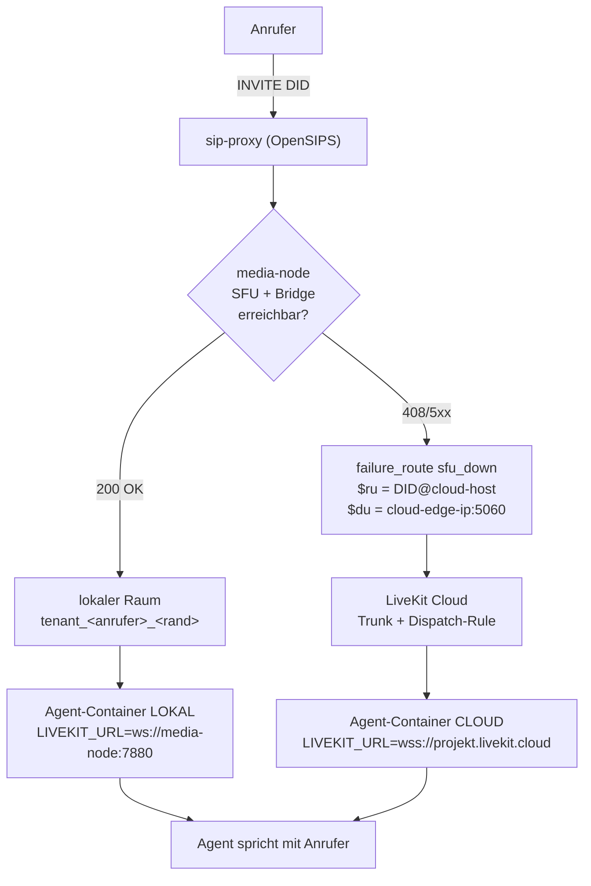

# Fallback: lokaler SFU fällt aus → LiveKit Cloud übernimmt

Kurzfassung: Der `sip-proxy` versucht **immer zuerst** den lokalen `media-node`. Antwortet der mit
`408` oder `5xx`, wird **derselbe Anruf** per `failure_route` an die LiveKit Cloud weitergegeben,
wo ein zweiter Worker-Container denselben Agenten fährt. Der Anrufer merkt nur ~2–4 s Verzögerung.

---

## 0. Bild (grafisch)



## 1. Was auf dem Proxy passiert (Kern)

```c
# prio1 — jeder INVITE geht erst an den lokalen SFU
if (is_method("INVITE")) {
    xlog("L_INFO", "INVITE $fU -> $rU von $si | prio1 lokale SFU\n");
    $du = "sip:<MEDIA_NODE_IP>:5070";        # lokale SIP-Bridge
    t_on_failure("sfu_down");                # Failover scharf schalten
    if (!t_relay()) { t_reply(500, "Server Error"); }
    exit;
}

failure_route[sfu_down] {
    if (t_check_status("408|5[0-9][0-9]")) {                       # Timeout oder Serverfehler
        xlog("L_WARN", "lokale SFU antwortet $T_reply_code -> Fallback Cloud fuer $rU\n");
        $ru = "sip:" + $rU + "@<CLOUD_SIP_HOST>";                 # Cloud-Host im R-URI!
        $du = "sip:<CLOUD_EDGE_IP>:5060";                         # Versand an die Edge-IP
        t_on_failure("all_down");
        if (!t_relay()) { t_reply(500, "Server Error"); }
        exit;
    }
}

failure_route[all_down] {
    xlog("L_ERR", "Cloud-Fallback auch gescheitert: $T_reply_code\n");
    t_reply(503, "Service Unavailable");
}
```

Die vollständige Datei: [`../sip-proxy/opensips.cfg`](../sip-proxy/opensips.cfg).
Patch-Werkzeug für eine laufende Installation: `fallback-tools/fix_cloud_destination.py`.

**Die entscheidende Zeile ist das Paar `$ru` + `$du`.** Nur `$du` (wie im ersten Versuch) reicht nicht —
siehe Fehlerbild 1.

## 2. Was auf der Cloud-Seite nötig ist

| Objekt | Einstellung | Warum |
|---|---|---|
| SIP-Trunk | `numbers` = DID in **allen** Schreibweisen, die der Carrier liefern kann (`+49…`, `0049…`, `49…`, `0…`) | sonst „404 No trunk found" |
| SIP-Trunk | `allowed_addresses` = **IP des sip-proxy** (`/32`) | die Cloud prüft die Quell-IP |
| Dispatch-Rule | `roomPrefix` = `<praefix>_` | Raumname |
| Dispatch-Rule | `roomConfig.agents = [{ agentName: <agent> }]` | **sonst startet kein Worker** — der Anrufer hört nur Klingeln |
| Dispatch-Rule | `trunkIds` = der Trunk | Verknüpfung |

Anlegen/aktualisieren (idempotent): `fallback-tools/create_cloud_sip.py` (liest `LIVEKIT_URL`,
`LIVEKIT_API_KEY`, `LIVEKIT_API_SECRET`, `CLOUD_DIDS`, `CLOUD_ALLOWED` aus der Umgebung).

Wichtig: Beim LiveKit-**Cloud**-Projekt unterscheidet sich der **SIP-Hostname** von der Projekt-URL.
Der SIP-Host steht im Dashboard unter *Telephony/SIP* (Form `<random>.sip.livekit.cloud`) — nicht
`<projekt>.sip.livekit.cloud`. Falscher Host ⇒ „404 No trunk found".

## 3. Was auf dem Worker-Node nötig ist

Zwei Container, **gleiches Image**, unterschiedliche Umgebung:

```bash
# Container A — lokaler Betrieb
docker run -d --name <worker>-local --restart unless-stopped \
  --env-file /root/worker-local.env \
  -v /opt/<worker>:/app -w /app node:22-slim node agent.js start

# Container B — Fallback (LiveKit Cloud)
docker run -d --name <worker>-cloud --restart unless-stopped \
  --env-file /root/worker-cloud.env \
  -v /opt/<worker>:/app \
  -v /etc/ssl/certs:/etc/ssl/certs:ro \
  -e NODE_EXTRA_CA_CERTS=/etc/ssl/certs/ca-certificates.crt \
  -w /app node:22-slim node agent.js start
```

`worker-local.env`: `LIVEKIT_URL=ws://<media-node>:7880`
`worker-cloud.env`: `LIVEKIT_URL=wss://<projekt>.livekit.cloud`

**Der CA-Mount ist Pflicht** (Fehlerbild 3). Startskript: `fallback-tools/start_worker_cloud.sh`.

## 4. Beweisen, dass der Fallback läuft (nicht behaupten!)

Auf dem `sip-proxy`:

```bash
# 1) Testanruf auslösen (Skript auf einem Rechner, der als Quelle erlaubt ist)
python3 test_sip_call.py <DID>

# 2) Parallel mitschneiden — sieht man das INVITE zum Cloud-Edge?
timeout 45 tcpdump -n -i any -A -s0 'udp port 5060' > /tmp/tcp.txt &
grep -a "INVITE sip:" /tmp/tcp.txt            # Ziel muss <cloud-sip-host> sein
grep -a "SIP/2.0" /tmp/tcp.txt                # 100 → 180 → 200 OK
```

Auf dem `worker-node`:

```bash
docker logs --since 5m <worker>-cloud | grep -a "received job request"   # Job angenommen
docker logs --since 5m <worker>-cloud | grep -a "Guten Tag"              # Agent hat gesprochen
docker logs --since 5m <worker>-local | grep -a "received job request"   # muss LEER sein (im Ausfall)
```

Auf der Cloud (API): Räume der letzten Minuten listen, Teilnehmer prüfen —
`fallback-tools/list_cloud_rooms.py`. Ein Fallback-Anruf erscheint als
`<praefix>_<caller>_<random>` mit Teilnehmern `sip_<caller>` **und** `agent-<jobID>`.

Rohbelege eines echten Durchlaufs: [`../fallback-tools/evidence/`](../fallback-tools/evidence/).

**Kostenneutralität prüfen:** Nach `systemctl start livekit` auf dem `media-node` einen Testanruf
machen — im Mitschnitt darf **kein** Paket zur Cloud auftauchen, im Cloud-Worker-Log **kein**
neuer Job. Dann läuft wieder alles lokal (0 Cloud-Minuten).

## 5. Fehlerbilder (alle drei hatten wir wirklich)

| # | Symptom | Ursache | Fix |
|---|---|---|---|
| 1 | Proxy-Log sagt „→ Fallback Cloud", aber es geht **kein Paket** raus; Anrufer bekommt nur `503`. Im Log `tm:update_uac_dst: no valid destination found for <sip:…@<cloud-host>>` | nur `$du` auf den Hostnamen gesetzt; OpenSIPS baut die Branch dann ohne brauchbares Ziel ⇒ stiller Abbruch (`all_down`) | `$ru` **und** `$du` setzen (`$ru` = Cloud-Host, `$du` = Edge-IP) |
| 2 | Direkter Test an die Cloud: `404 No trunk found` | falscher SIP-Host (`<projekt>.sip.livekit.cloud` statt `<random>.sip.livekit.cloud`) | richtigen SIP-Host aus dem Dashboard nehmen |
| 3 | Cloud-Worker startet, nimmt aber **keinen** Job an; Log: `ConnectError: no native root CA certificates found` | Container ohne Root-CAs (TLS zu LiveKit Cloud scheitert) | `/etc/ssl/certs` mounten + `NODE_EXTRA_CA_CERTS` setzen |
| 4 | Anruf klingelt, aber **niemand** spricht, obwohl `200 OK` kommt | Dispatch-Rule ohne `roomConfig.agents` ⇒ Agent wird nie dispatcht | `roomConfig.agents = [{agentName: …}]` setzen |
| 5 | Anruf scheitert sporadisch mit `486 busy`/flood-Warnungen | Dispatch-Rule/Trunk fehlt teilweise, Carrier wiederholt | Trunk + Rule vollständig anlegen (Skript ist idempotent) |

## 6. Betriebsregeln, die sich bewährt haben

- Der Fallback ist **kein Ersatz** für den lokalen Betrieb: er ist für den Ausfall da. Cloud-Minuten kosten Geld.
- Nach **jeder** Änderung an Proxy/Config: Syntax prüfen (`opensips -C -f /etc/opensips/opensips.cfg`), neu starten, **einen** Testanruf, Mitschnitt ansehen. Erst dann „fertig" melden.
- Backup vor jeder Config-Änderung (`.bak`-Datei daneben), Rollback = Datei zurück + Neustart.
- Der Anrufer darf **nie** Stille hören: `all_down` antwortet mit `503`, damit der Carrier eine
  Ansage/Weiterleitung machen kann.
