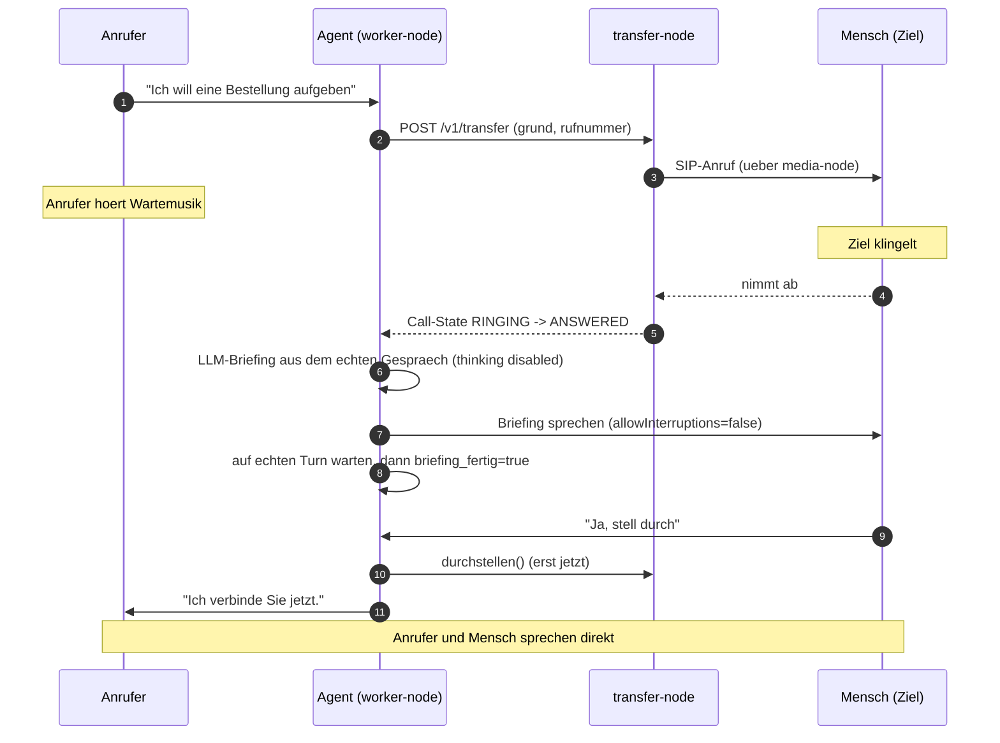

# Warmtransfer mit LLM-Briefing

Der Agent stellt **nicht stumm** durch, sondern formuliert vorher ein Briefing aus dem, was er im
Gespräch wirklich erfahren hat, sagt es dem Menschen am anderen Ende und fragt, ob durchgestellt
werden soll.

```
Anrufer ──▶ Agent ──▶ transfer-node ──▶ Ziel (Marktleiter)
                        │
                        ├─ Anrufer hört Wartemusik, Ziel klingelt
                        └─ Agent spricht parallel (LLM):
                           "Frau Meier fragt zu ihrer Bestellung nach: zwei Vollmilch und
                            eine Butter, insgesamt 12,40 Euro. Geliefert werden soll an die
                            Hauptstraße 5. Soll ich durchstellen?"
```

Betriebsweg: `worker-node` (Agent) → HTTP `POST http://<transfer-node>:9101/v1/transfer` →
`media-node` (SIP out, Anruf zum Ziel) → Bridge verbindet am Ende Anrufer und Ziel.

---

## 1. Ablauf in Phasen




| Phase | Wer handelt | Was passiert |
|---|---|---|
| `RINGING` | transfer-node | Ziel klingelt; Anrufer hört Wartemusik; Agent ist passiv |
| `AI_BRIEFING` | Agent | Briefing + Rückfrage werden **gesprochen** (reine TTS-Ansage, Agent hört danach wieder zu) |
| `TARGET_ANSWER` | Ziel | Ziel antwortet — der Agent hört das als **echten Turn** und kann reagieren |
| `BRIDGING` | transfer-node | Nach `durchstellen()` werden Anrufer ↔ Ziel verbunden, Agent tritt aus der Leitung |
| Abbruch | Agent/Ziel | Ziel lehnt ab → Agent nimmt das Gespräch wieder auf (kein stilles Auflegen) |

Die vier Einbaustellen im Agenten-Code inkl. Reihenfolge und Codeausschnitten stehen in
[`../warm-transfer/integration.md`](../warm-transfer/integration.md). Das Briefing-Modul liegt als
`../warm-transfer/briefing.mjs` (abhängigkeitsfrei, Node ≥ 18) bei, Trockentest:
`node ../warm-transfer/test-briefing.mjs`.

## 2. Drei Fallstricke, die uns Zeit gekostet haben

### 2.1 Reasoning-Modelle liefern leeren Text

Reasoning-Modelle (z. B. `deepseek-v4.1-flash`, `gemma-4-31b`) schicken ohne Schalter erst
Reasoning-Tokens und dann **`content = ""`** mit `finish_reason: "length"`:

```
ohne Parameter              content 0 Zeichen     reasoning 683 Zeichen    finish=length
thinking: {type:disabled}   content 196 Zeichen   reasoning 0              finish=stop
reasoning_effort: "none"    content 200 Zeichen   reasoning 0              finish=stop
```

→ Immer `thinking: { type: 'disabled' }` mitsenden. Das ist **auch** für den Telefon-Agenten
selbst Pflicht (Sprach-Agenten dürfen nicht „tief nachdenken": Latenz).

### 2.2 Der Sprech-Kanal entscheidet über die Phasen

- `session.generateReply()` = **voller LLM-Turn**: Der Agent generiert, spricht, der Turn ist
  beendet — während des Sprechens hört er nicht zu, danach ist die Gesprächsphase eine andere.
  Ergebnis: Briefing ins Leere, Anrufer hört Stille.
- `session.say(text, { allowInterruptions: false, addToChatCtx: true })` = **reine TTS-Ansage**: Der
  Agent bleibt im Zuhören-Modus und hört die Antwort des Ziels als echten Turn.

```js
// falsch
session.generateReply({ instructions: `Sage wortgleich: "${text}"` });

// richtig
const handle = session.say(text, { allowInterruptions: false, addToChatCtx: true });
await handle.waitForPlayout();      // erst danach gilt das Briefing als "fertig"
```

### 2.3 Das LLM stellt zu früh durch

Im Testlog rief das Modell `durchstellen()` **zwei Sekunden nach dem Klingeln** auf — bevor
irgendjemand das Briefing gehört hatte. Gegenmaßnahmen (beide nötig):

- **Harte Sperre im Tool**: `durchstellen()` wird abgelehnt, solange `briefing_fertig === false`,
  und gibt eine klare Anweisung zurück („Du bist still, warte auf die Antwort").
  Erst `waitForPlayout()` setzt das Flag.
- **Klarer Tool-Rückgabewert** von `verbinden()`: „Der Code spricht jetzt Briefing und Frage — nicht
  du. Du bist STUMM, bis der Zielteilnehmer antwortet."

## 3. Latenz: Briefing parallel zum Klingeln

Der Transferaufbau dauert 5–7 s (Controller wählt, Ziel klingelt). Formuliert man das Briefing erst
danach, ist es 2–3 s zu spät. Deshalb startet der LLM-Call **mit** dem Transfer und wird später
awaited:

```js
const briefingPromise = formuliereBriefing(fakten).catch(() => '');   // sofort starten
await fetch(`${CONTROLLER}/v1/transfer`, { … });                      // 5–7 s, parallel
// … warten bis Phase AI_BRIEFING …
const llmBrief = await briefingPromise;                               // längst fertig
```

Gemessen: 352–578 ms pro Briefing (`deepseek-v4.1-flash`, `thinking: disabled`, ~66 Output-Tokens).

## 4. Fallback ohne LLM

Liefert das Modell nichts Brauchbares (leer, < 40 Zeichen, > 600 Zeichen, HTTP-Fehler, Timeout 2,6 s),
spricht der **Code** die deterministische Ansage — der Transfer funktioniert also auch bei LLM-Ausfall:

```
Hier ist Ihre digitale Assistentin, ich habe einen Anrufer fuer Sie.
Anliegen: … Anrufer: … Bestellung: … Lieferung: …
Soll ich durchstellen?
```

## 5. Bekannte Einschränkung

Das Modell übernimmt Formulierungen aus dem `grund`-Feld des Agenten. Steht dort „es ging um eine
Bestellung", obwohl der Anrufer nur eine Frage hatte, landet das auch im Briefing.
Gegenmittel: `grund` knapp halten („Frage zum Liefertermin") oder im System-Prompt schärfen:
nur Fakten, keine Interpretation.

## 6. Umgebungsvariablen (Auszug)

```
LLM_BASE_URL    https://<llm-host>/v1
LLM_MODEL       <modell>            # Reasoning-Modell → thinking: disabled
LLM_API_KEY     <key>
CONTROLLER_URL  http://<transfer-node>:9101
TRANSFER_NUMBER +49…                # Ziel des Warmtransfers
```

## 7. Prüfen (ohne Telefonie)

```bash
node warm-transfer/test-briefing.mjs        # drei Testfälle, gibt die formulierten Briefings aus
```

Im echten Anruf gilt: Agent spricht das Briefing **hörbar**, das Ziel antwortet, **dann** erst
`durchstellen()` im Log — und die Verbindung steht. Ein Transfer-Log ohne „Briefing" davor ist ein
Fehler, kein Erfolg.
